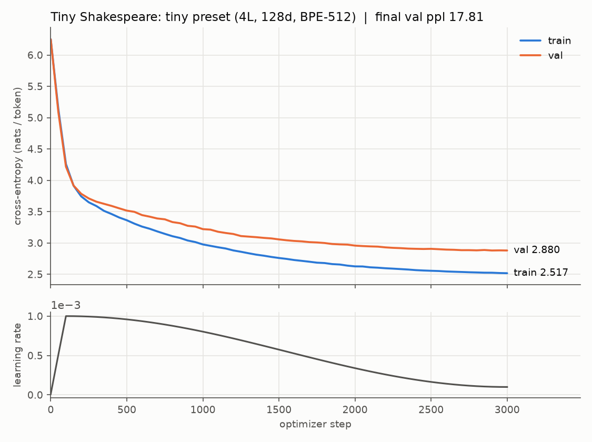
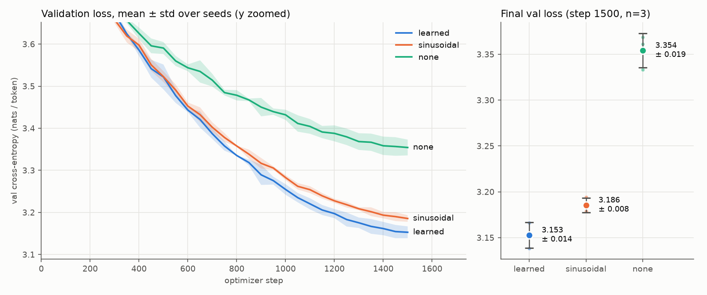

# gpt-scratch

A decoder-only, GPT-style transformer written from scratch in pure PyTorch: a byte-level BPE
tokenizer, explicit multi-head causal attention, pre-LN blocks, a training loop with exact
checkpoint/resume, and an evaluation/sampling CLI. Every number in this README comes from
a file committed under [`results/`](results/) or [`artifacts/`](artifacts/), and every file has
a command that regenerates it.



## What this is / What this is NOT

**This is**
- A small educational GPT (0.875M parameters in the committed checkpoint) that trains on Tiny
  Shakespeare in ~2 min on a laptop GPU (RTX 4060) or an estimated ~17 min on a laptop CPU.
- A readable reference for every piece: tokenizer, attention, block, model, optimizer setup,
  LR schedule, mixed precision, checkpointing, perplexity, and sampling. There is no
  framework magic. The tests pin down correctness (attention against an oracle, causality
  via perturbation and Jacobian, bit-exact resume).
- A small controlled experiment: positional encoding {learned, sinusoidal, none} x 3 seeds.

**This is NOT**
- GPT-2 scale. GPT-2 small is 124M parameters with a 50,257-token vocabulary, trained on
  ~40 GB of WebText; this model is ~140x smaller and trained on 1 MB of Shakespeare.
- Instruction-tuned, RLHF'd, or chat-capable. It continues text in a Shakespeare-like style
  and nothing else.
- Production code: no KV cache, no fused/flash attention (deliberately), no distributed
  training, no serving path.

## Results

| Claim | Number | Artifact |
|---|---|---|
| Tiny model: final val loss (20-batch estimate, step 3000) | **2.880** nats/token (ppl 17.81) | [`results/tiny_loss.csv`](results/tiny_loss.csv), [`.png`](results/tiny_loss.png) |
| Tiny model: full val split, non-overlapping 128-token windows | ppl **17.93** (2.886 nats/token = 2.22 bits/byte) | [`results/tiny_val_perplexity.json`](results/tiny_val_perplexity.json) |
| Checkpoint size | **3.52 MB** (< 5 MB) | [`artifacts/checkpoints/tiny.pt`](artifacts/checkpoints/tiny.pt) |
| A real generation | 400 tokens, T=0.8, top-k 50, top-p 0.95 | [`results/sample.txt`](results/sample.txt) |
| GPU throughput (RTX 4060 Laptop, bf16) | 137k-163k tokens/s, 83 s of training (eval excluded) | `tokens_per_sec`, `elapsed_s` columns of `tiny_loss.csv` |
| CPU throughput (same config, 8 threads, fp32) | ~11.9k tokens/s | [`results/cpu_timing_tiny.csv`](results/cpu_timing_tiny.csv) |
| Overfit one batch (CPU) | loss 0.093 after 52 steps, 0.5 s | [`results/smoke.log`](results/smoke.log); `make smoke` asserts < 0.1 and < 60 s |
| Positional-encoding ablation | see below | [`results/ablation_pos_enc.csv`](results/ablation_pos_enc.csv), [`.png`](results/ablation_pos_enc.png), raw runs in [`results/ablation_runs/`](results/ablation_runs/) |

Sample excerpt (from [`results/sample.txt`](results/sample.txt), prompt `ROMEO:`):

```
DUKE VINCENTIO:
Most mercy, sir, the Angelo
His nursed stealing, whose friends.

POMPEY:
O, that who! 'tis Pettried, and my grace
As if you find to make your brother,
Not against the dangerous souls,
```

It has the right shape (speaker tags, verse line lengths, archaic register) and the wrong
meaning, which is what you'd expect from a 0.9M-parameter model.

### Positional-encoding ablation (3 configs x 3 seeds)

Identical model, data, and schedule (`ablation` preset: 4 layers, d=128, 1,500 steps x 4,096
tokens); only `pos_encoding` and `seed` change.

| pos_encoding | final val loss (mean ± std, n=3) | final val ppl | per-seed |
|---|---|---|---|
| learned | **3.153 ± 0.014** | 23.40 ± 0.33 | 3.138, 3.154, 3.166 |
| sinusoidal | 3.186 ± 0.008 | 24.18 ± 0.19 | 3.179, 3.183, 3.194 |
| none | 3.354 ± 0.019 | 28.63 ± 0.53 | 3.333, 3.361, 3.369 |

std is the sample standard deviation (ddof=1) over seeds 0, 1, 2.



What I read from this:
- **Learned beats sinusoidal by 0.033 nats**, and every learned seed beats every sinusoidal
  seed. With only 3 seeds and one budget, this is consistent but small evidence. At 128 tokens
  of context, a free 128x128 table has no length-generalization handicap to pay for.
- **No positional encoding still learns** (3.35, far below the 6.24 uniform-init loss), because a
  causal mask leaks position implicitly: token *t* attends over exactly *t+1* keys
  (Haviv et al., 2022). At this scale it costs 0.2 nats, roughly 6x the learned/sinusoidal gap.
- The sinusoidal result depends on a scaling choice that I got wrong at first. See
  "Things that broke" #2.

## Architecture

```
 token ids (B, T)                    T <= block_size = 128
      |
 [ tok_emb  V x C ]----------------------------------------+  (tied weight, optional)
      |                                                    |
      +-- (+) positional:  learned (T x C table)           |
      |                  | sinusoidal (fixed, std 0.02)    |
      |                  | none                            |
   dropout                                                 |
      |                                                    |
 +----v--------------------- Block x N (pre-LN) -------+   |
 |    x ----------------------------+                  |   |
 |    |                             |                  |   |
 |  LayerNorm                       |                  |   |
 |    |                             |                  |   |
 |  Q = x Wq   K = x Wk   V = x Wv   (C -> H heads x D)|   |
 |  A = softmax(Q K^T / sqrt(D) + causal_mask)         |   |
 |  y = concat_h(A V) Wo  -> dropout                   |   |
 |    |                             |                  |   |
 |   (+) <--------------------------+   residual       |   |
 |    x ----------------------------+                  |   |
 |  LayerNorm                       |                  |   |
 |  Linear C->4C, GELU, Linear 4C->C -> dropout        |   |
 |   (+) <--------------------------+   residual       |   |
 +----|------------------------------------------------+   |
      |                                                    |
  LayerNorm (final)                                        |
      |                                                    |
 [ lm_head  C x V ] <--------------------------------------+
      |
 logits (B, T, V) --> cross-entropy vs. ids shifted left by one
```

Code map: [`tokenizer.py`](src/gpt/tokenizer.py) (byte BPE) · [`attention.py`](src/gpt/attention.py)
(Q/K/V, scaled dot-product, mask, heads) · [`block.py`](src/gpt/block.py) (pre-LN block, MLP) ·
[`model.py`](src/gpt/model.py) (embeddings, init, tying, optimizer groups) ·
[`train.py`](src/gpt/train.py) (loop, schedule, bf16, accumulation, checkpoint/resume, smoke) ·
[`eval.py`](src/gpt/eval.py) (perplexity, sampling) · [`config.py`](src/gpt/config.py) (presets; every
field is a CLI flag) · [`plots.py`](src/gpt/plots.py) (CSV -> PNG, ablation aggregation).

## Reproducing every claim

Windows needs GNU make plus Git Bash (`winget install ezwinports.make`); Linux and macOS work as is.
For a CUDA build of torch, use `make install TORCH_INDEX=https://download.pytorch.org/whl/cu128`.

| Command | What it does / proves | Writes | Time (this machine) |
|---|---|---|---|
| `make install` | venv + CPU torch + package in editable mode | `.venv/` | 3.5 min (fresh, CPU wheel) |
| `make test` | 65 tests: tokenizer round-trips + naive-BPE oracle, attention vs. oracle and loop reference, causality (perturbation, Jacobian, negative control), shapes/params/tying, sampling filters, LR schedule, bit-exact resume, overfit one batch | — | 6-12 s CPU |
| `make smoke` | overfits one batch on CPU; **asserts** loss < 0.1 and time < 60 s | `results/smoke.log` | < 1 s |
| `make data` | downloads Tiny Shakespeare; trains BPE-512 on the train split only; writes uint16 token files | `data/tinyshakespeare/` | ~2 s |
| `make train-tiny` | trains the tiny preset, plots, evaluates full-split perplexity, samples | `results/tiny_loss.{csv,png}`, `results/tiny_val_perplexity.json`, `artifacts/checkpoints/tiny.pt`, `results/sample.txt` | 2m07s GPU / ~17 min CPU (estimated from measured CPU throughput) |
| `make ablation` | {learned, sinusoidal, none} x seeds {0,1,2}, then mean ± std | `results/ablation_runs/*.csv`, `results/ablation_pos_enc.{csv,png}` | 9 min GPU |
| `make breaks` | deliberate breakages (causal mask removed; no warmup + 10x LR + no clip), plus samples | `results/breaks/*`, `results/breaks.png` | 3 min GPU |
| `.venv/bin/python scripts/probe_sinusoidal_scale.py` | sinusoidal table: matched-std vs. unscaled vs. Vaswani √d scaling | `results/sinusoidal_scale/*.csv` | ~2 min GPU |
| `make sample` | regenerates the sample from the committed checkpoint (deterministic) | `results/sample.txt` | ~3 s CPU |
| `.venv/bin/python -m gpt.eval perplexity --ckpt artifacts/checkpoints/tiny.pt` | full-split val perplexity (needs `make data`; also run by `make train-tiny`) | stdout, or `--out file.json` | ~2 s |
| `make docker && make docker-test` | builds a CPU image and runs the test suite inside it | image `gpt-scratch` | ~1 min build |
| `bash scripts/train_small.sh` | 10.7M-parameter GPU preset (6L, 384d, T=256). Not part of the acceptance set, and **no results are claimed from it** | `results/small_loss.*` | — |

Resume a run after an interruption: `python -m gpt.train --preset tiny --resume true`.

## Design decisions

**Pre-LN instead of post-LN.** In each block, LayerNorm runs on the *input* of each sub-layer, and the residual
path `x -> x + f(LN(x))` stays an identity from embeddings to the final LayerNorm. Xiong et al.
(2020) show that post-LN puts large gradients near the output at initialization, which is why
it needs a carefully tuned warmup. Pre-LN trains stably with less tuning. GPT-2 made the same
move (Radford et al., 2019, §2.3) and added the final LayerNorm used here. Pre-LN is not free:
the residual stream's magnitude grows with depth, which is why the residual-output projections
are initialized at `0.02/sqrt(2·n_layer)` (also from GPT-2), a choice `test_residual_projection_init_is_scaled` pins down.

**Linear warmup + cosine decay.** Adam's second-moment estimates are poor for the first few
hundred steps, so a full-size step taken against them can push the model into a bad region it
spends a long time escaping. Warmup (100 steps here) avoids that. Cosine decay (Loshchilov &
Hutter, 2017) then anneals smoothly to `min_lr = 0.1·lr`, which is GPT-3's choice (Brown et al.,
2020, App. B), along with β2 = 0.95, weight decay 0.1, and clipping at 1.0. The cost of
skipping warmup is measured below rather than asserted: "Things that broke" #4.

**Byte-level BPE.** Starting from 256 byte values makes the tokenizer total: any Unicode string
(emoji, ZWJ sequences, control characters) encodes with no `<unk>` token, and
`decode(encode(s)) == s` exactly (tests cover CJK, combining marks, flags, and 200 random
strings). BPE merges (Sennrich et al., 2016) then compress frequent byte sequences: 1.94
bytes/token on the train split at a vocabulary of 512. I used GPT-2's pre-tokenization regex,
rewritten for stdlib `re`, so merges never cross word or punctuation boundaries ("dog." and
"dog!" share "dog"). Training is incremental: a pair-to-words index plus a lazy max-heap, so
each merge touches only the affected words. It takes 0.5 s on 1 MB, and
`test_incremental_trainer_matches_naive` checks it against a textbook recount-everything
implementation. The tokenizer never sees the validation text.

**Weight tying (toggleable, on by default).** The input embedding and the output projection
both live in "token space". Sharing them (Press & Wolf, 2017; Inan et al., 2017) removes V·C
parameters, which is 65,536 of 875,264 here (7.5%, `test_weight_tying_toggle`) and much more
for large vocabularies. It also gives rare tokens' input embeddings a gradient every
step through the softmax. Tying happens *after* initialization, so the one shared tensor has
the embedding's init. GPT-2 ties these weights as well.

Smaller choices, each with a reason:
- **Softmax in fp32 under bf16 autocast.** bf16 has 8 mantissa bits, so a sum of exponentials
  over 128 keys loses real precision. Only half-precision inputs are upcast (#1 below).
- **Separate Q, K, V projections** instead of one fused `C -> 3C` matmul: it's slower, but each
  projection is visible on its own line. The tests check multi-head attention against
  per-head slices and against PyTorch's kernel (used there only as an oracle).
- **Weight decay only on matrices** (`ndim >= 2`); biases and LayerNorm gains are not decayed.
- **Evaluation uses its own fixed-seed generator.** Every eval sees the same batches, so the
  curves are lower variance, and the training RNG stream is untouched, which is what makes
  resume bit-exact (`test_resume_is_bit_exact`). A side effect is that changing
  `eval_interval` from 250 to 50 reproduced the final val loss 2.8797 exactly.
- **Train/val split before tokenization**, contiguous 90/10, so no passage straddles the split.

### Conceptual borrowings from nanoGPT (read, not copied)
Karpathy's [nanoGPT](https://github.com/karpathy/nanoGPT) shaped several choices: uint16
`.bin` token files with random-window batches, `estimate_loss` averaging over a few batches,
weight-decay grouping by tensor rank, the `0.02/sqrt(2L)` residual init (originally from GPT-2),
and the overall loop structure. Everything here was written independently, and several
choices differ. Q/K/V are separate rather than fused, attention is fully explicit (no
`F.scaled_dot_product_attention` path), there is a BPE tokenizer instead of characters or
tiktoken, eval uses its own RNG, resume restores every RNG stream, and positional encoding is
pluggable.

## Things that broke

Each entry has a symptom, a cause, a fix, and the file that shows it. #1, #2, #5, #6, and #7 were hit
for real while building; #3 and #4 are deliberate breakages run with `make breaks`.

**1. My attention disagreed with PyTorch's at 2.8e-7 in float64.** The first `make docker-test`
run reported 1 failure in 65 tests: `test_attention_matches_torch_oracle`, max abs diff
`2.78e-07`. That is float32-sized error in a float64 test. *Cause:* the line written to protect
bf16, `F.softmax(scores.float())`, also **down**casts fp64 to fp32. *Fix:* upcast only
fp16/bf16 ([`attention.py`](src/gpt/attention.py)). *Lesson:* run oracle tests in fp64, since a
fp32 tolerance would have hidden this.

**2. Sinusoidal positions drowned out the tokens.** First probe: sinusoidal val loss **3.996**
vs. learned **3.138** at the same budget, which is too large a gap to be a real property of
sinusoids. *Cause:* the raw sin/cos table has per-element RMS ≈ 0.71, while token embeddings
are initialized at std 0.02. Position was ~35x louder than identity, and pre-LN normalizes the
*sum*, so the token signal was a small perturbation. *Fix:* rescale the fixed table to std 0.02
so that it starts at the same magnitude as the learned table. That isolates the question the
ablation asks (fixed vs. learned form). The probe also tries Vaswani et al.'s fix (multiply
embeddings by √d): matched-std **3.179**, Vaswani **3.275**, unscaled **3.996**
([`results/sinusoidal_scale/`](results/sinusoidal_scale/),
[`scripts/probe_sinusoidal_scale.py`](scripts/probe_sinusoidal_scale.py)). Without this, the
ablation would have "shown" sinusoidal encodings to be terrible.

**3. Deliberate: remove the causal mask (`--causal false`).** Train and val loss fall to
**0.030**, against a 3.138 baseline, which would read as a spectacular result. Val loss
tracks the baseline until step 500 (3.24), then collapses to 0.098 by step 650, once
attention learns to read the next token directly from the input. The sample is degenerate:
`ROMEO:OMEOROMEOMOMEOMOMEOMEOMEOMOMROOMOMEOM...`
([`results/breaks/no_causal_mask_sample.txt`](results/breaks/no_causal_mask_sample.txt), against
the healthy [`baseline_sample.txt`](results/breaks/baseline_sample.txt)). With teacher forcing,
leakage looks like success, and at generation time there is no future to read. *Guard:*
`test_causality.py` checks causality two independent ways and includes a negative control that
asserts the mask-less model **fails** the check, so the test is known to be able to fail.
Reverted (the default is `causal=True`).

**4. Deliberate: no warmup + 10x LR (1e-2) + no gradient clipping.** The loss stalls on a
plateau at ~5.19 from step 50 to step 200, the unigram-ish regime that the healthy run leaves
by step 100. It never recovers the gap: final val **3.922** vs. **3.138**
([`results/breaks.png`](results/breaks.png),
[`no_warmup_lr10x_no_clip.csv`](results/breaks/no_warmup_lr10x_no_clip.csv)). This run changes
three things at once, so it shows the combined effect and does not attribute it to any one of
them. Reverted.

**5. The LR plot lied about the warmup.** In the first `tiny_loss.png`, warmup appeared to take
250 steps instead of 100, because the CSV logged only at eval steps (every 250) and matplotlib
drew a straight line between them. *Fix:* log every 50 steps for the tiny and ablation presets,
and re-run. The plot now shows the 100-step ramp, and the final val loss is the same 2.8797 (the
separate eval RNG means extra evals don't change training).

**6. The "no forbidden APIs" test flagged my own docstring.** A line-based grep for
`nn.MultiheadAttention` / `F.scaled_dot_product_attention` matched the docstring in
`attention.py` that says these are *not* used. *Fix:* walk the AST and flag only real
`Attribute` and `Import` nodes ([`tests/test_attention.py`](tests/test_attention.py)).

**7. I wrote a test that could not fail, and a Makefile that could not run on Windows.** The
first draft of a tokenizer test used set arithmetic that was always true, which I caught on
review. It is now a hand-worked two-merge example plus the naive-BPE oracle. Separately, the
machine had no `make` or `gh`, `python3` resolves to the Microsoft Store stub on Windows, and
venvs put the interpreter at `.venv/Scripts/python.exe` instead of `.venv/bin/python`. The
Makefile switches on `$(OS)`, and `.gitattributes` forces LF on scripts so that a Windows
checkout still runs in Linux CI and Docker.

## Limitations and next steps

- **Tiny data, many epochs.** 3,000 steps x 4,096 tokens = 12.3M tokens, which is **23.8
  passes** over 516k unique training tokens. The token-to-parameter ratio (~14) is near the
  Chinchilla heuristic of ~20 (Hoffmann et al., 2022), but Chinchilla assumes *unique* tokens.
  Repeated data loses value after a few epochs (Muennighoff et al., 2023), and the widening
  train/val gap in `tiny_loss.png` (2.52 vs. 2.88) shows the model starting to memorize. Next:
  a larger corpus and a small scaling sweep (params x tokens) to fit an actual Kaplan/Chinchilla-style
  curve instead of citing one.
- **The ablation is narrow.** One model size, one 1,500-step budget, context 128, 3 seeds.
  Positional-encoding rankings are known to change with length extrapolation (Kazemnejad et
  al., 2023 found that NoPE generalizes to longer contexts better). Next: evaluate at T > 128
  with RoPE/ALiBi variants, and use more seeds.
- **Evaluation.** Perplexity uses non-overlapping windows, which is pessimistic for early tokens
  in each window. A sliding-window evaluation would be tighter. Perplexity is per *BPE-512*
  token, so compare across tokenizers with bits/byte (2.22 here).
- **Generation** has no KV cache, so each new token recomputes the whole window, which costs
  O(T²) per token. That's fine at T=128.
- **Determinism.** Bit-exact resume is *tested* on CPU. On CUDA, cuBLAS/atomics can be
  nondeterministic, and `torch.use_deterministic_algorithms` is not enabled. In practice the
  re-run on this GPU reproduced 2.8797 exactly, but that is not a guarantee.
- **Not done:** `torch.compile`, flash attention, multi-GPU (DDP/FSDP), special tokens
  (`<|endoftext|>`), dropout/regularization sweeps.

## References

- Radford et al., 2019. *Language Models are Unsupervised Multitask Learners* (**GPT-2**): byte-level BPE, pre-LN placement + final LayerNorm, residual init scaling.
- Brown et al., 2020. *Language Models are Few-Shot Learners* (**GPT-3**), arXiv:2005.14165: warmup + cosine to 10%, β2=0.95, weight decay 0.1, clip 1.0.
- Hoffmann et al., 2022. *Training Compute-Optimal Large Language Models* (**Chinchilla**), arXiv:2203.15556.
- Vaswani et al., 2017. *Attention Is All You Need*, arXiv:1706.03762: scaled dot-product attention, sinusoidal encodings.
- Xiong et al., 2020. *On Layer Normalization in the Transformer Architecture*, arXiv:2002.04745: pre-LN vs. post-LN.
- Sennrich et al., 2016. *Neural Machine Translation of Rare Words with Subword Units*, arXiv:1508.07909: BPE.
- Press & Wolf, 2017. *Using the Output Embedding to Improve Language Models*, arXiv:1608.05859; Inan et al., 2017, arXiv:1611.01462: weight tying.
- Loshchilov & Hutter, 2019. *Decoupled Weight Decay Regularization* (AdamW), arXiv:1711.05101; 2017, *SGDR*, arXiv:1608.03983: cosine schedule.
- Holtzman et al., 2020. *The Curious Case of Neural Text Degeneration*, arXiv:1904.09751: nucleus (top-p) sampling.
- Haviv et al., 2022. *Transformer Language Models without Positional Encodings Still Learn Positional Information*, arXiv:2203.16634.
- Kazemnejad et al., 2023. *The Impact of Positional Encoding on Length Generalization in Transformers*, arXiv:2305.19466.
- Kaplan et al., 2020. *Scaling Laws for Neural Language Models*, arXiv:2001.08361; Muennighoff et al., 2023. *Scaling Data-Constrained Language Models*, arXiv:2305.16264.
- Karpathy, *nanoGPT* (conceptual reference; see "Conceptual borrowings").
- Data: Tiny Shakespeare from Karpathy's *char-rnn* repository.
